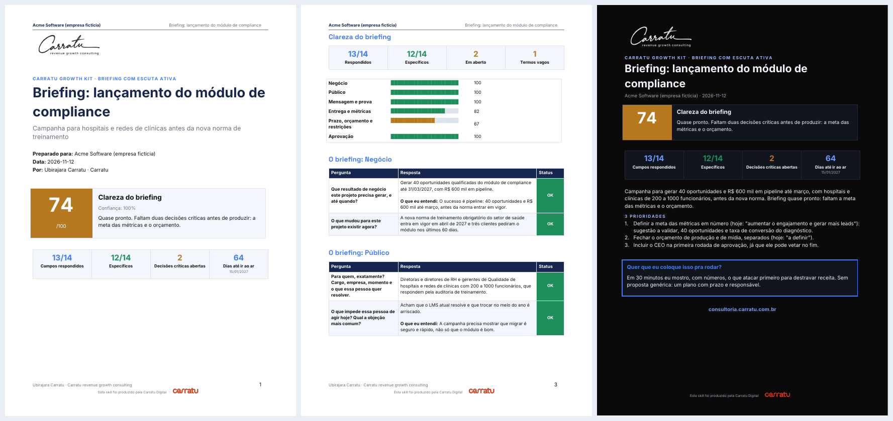

# Briefing com escuta ativa · Active-listening brief

**Carratu Growth Kit** · Skill para o Claude · por [Ubirajara Carratu](https://www.linkedin.com/in/carratu), autor de
*O Briefing da Vida* · [Carratu revenue growth consulting](https://consultoria.carratu.com.br) · v1.0.0 (nov/2026)



## PT-BR

"Faz uma campanha para o lançamento." Todo profissional de marketing já recebeu esse pedido, e quase todo retrabalho
começa nele. Esta skill faz o Claude **perguntar antes de produzir**: entrevista em rodadas curtas, devolve "o que eu
entendi" para confirmar, aprofunda as respostas vagas e mede a clareza do briefing. Só libera a produção quando não há
decisão crítica em aberto.

### O que ela entrega

- **Roteiros por tipo de projeto**: campanha, landing page, conteúdo, evento, lançamento de produto e identidade de marca,
  com o porquê de cada pergunta e perguntas de aprofundamento.
- **Técnicas de escuta ativa** na entrevista: parafrasear, quantificar, concretizar, perguntar o porquê, nomear, contraste.
- **Régua de clareza 0-100**: detecta termos vagos ("aumentar vendas", "moderno", "a definir"), falta de número e de
  data e público genérico. Campo crítico aberto (objetivo, público, métricas, prazo, orçamento, aprovação) trava a nota.
- **Lacunas com a próxima pergunta** a fazer, premissas e riscos explícitos com dono e data.
- **Documento do briefing** em DOCX e PDF: o que a pessoa disse, o que foi entendido e confirmado, e o que falta decidir.

### Como usar

> "Preciso de um briefing para a campanha de lançamento do módulo X"
> "O cliente pediu uma landing page nova. Me ajuda a fazer as perguntas certas?"
> "Revise este briefing e me diga o que está faltando" (anexe o briefing)

Instalação: baixe o ZIP e envie em **Configurações → Capacidades → Skills** no Claude. Exemplo completo (projeto fictício)
em [`examples/`](examples/).

## EN

Makes Claude interview before producing: short rounds of questions by project type, an "here is what I understood" check
after each round, follow-ups for vague answers and a 0-100 clarity score that blocks production while critical decisions
(goal, audience, metrics, deadline, budget, approval) are open. Outputs the brief as DOCX/PDF. Ask in English for English.

## Estrutura · Structure

```
carratu-briefing/
├── SKILL.md
├── references/  method.md (escuta ativa e régua) · templates.json (roteiros por tipo) · report-schema.md
├── scripts/
│   ├── briefing.py       roteiro, registro das respostas, régua de clareza e blocos do documento
│   └── carratu_*.py      dados, gráficos e relatório (comuns ao kit)
├── assets/
└── examples/
```

## Carratu Growth Kit

| Skill | Para quê · What for |
|---|---|
| [carratu-diagnostico-funil](https://github.com/biracarratu/carratu-diagnostico-funil) | Onde o funil vaza e quanto do pipeline é real |
| [carratu-ai-share-of-voice](https://github.com/biracarratu/carratu-ai-share-of-voice) | Quanto a sua marca aparece nas respostas das IAs |
| [carratu-icp-reverso](https://github.com/biracarratu/carratu-icp-reverso) | O ICP real, a partir de quem de fato compra |
| [carratu-abm-plays](https://github.com/biracarratu/carratu-abm-plays) | Contas em tiers, sinais de compra e plays de ABM |
| [carratu-briefing](https://github.com/biracarratu/carratu-briefing) | Briefing com escuta ativa antes de produzir |
| [carratu-relatorio-board](https://github.com/biracarratu/carratu-relatorio-board) | Marketing e vendas na língua do CFO |
| [carratu-diagnostico-seo-geo-aeo](https://github.com/biracarratu/carratu-diagnostico-seo-geo-aeo) | Visibilidade no Google e nas IAs |

## Licença · License

PolyForm Noncommercial 1.0.0: uso livre para fins não comerciais, inclusive dentro da sua empresa; uso comercial (vender
serviços feitos com a skill, embutir num produto pago) exige licença em
[consultoria.carratu.com.br](https://consultoria.carratu.com.br). Marcas e logos Carratu não estão incluídas. Detalhes
em `NOTICE.md`. Free for noncommercial use; commercial use requires a license.
